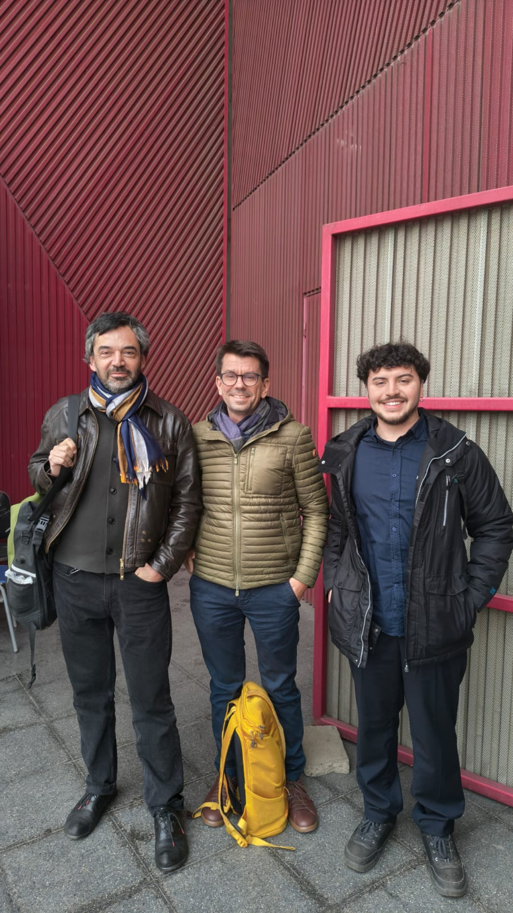

## El equipo JUSMER recibió a Patrick Sachweh durante su estadía en Chile 📚

Durante agosto de 2026, Patrick Sachweh, profesor de la Universität Bremen y decano de la Bremen International Graduate School of Social Sciences (BIGSSS), realizó una estadía breve de investigación en Chile. En este marco, el equipo JUSMER sostuvo una reunión con el investigador para intercambiar las agendas de investigación que cada parte desarrolla actualmente, en las cuales las temáticas de desigualdad y justicia social se encuentran estrechamente vinculadas.

En la instancia, el equipo JUSMER expuso los lineamientos generales del proyecto en curso, abordando sus conceptos centrales: la justicia de mercado, los criterios de merecimiento y, con mayor detalle, las creencias meritocráticas. Asimismo, se presentaron investigaciones ya finalizadas y otras que se encuentran en desarrollo. La sesión se realizó de manera presencial en la Facultad de Ciencias Sociales de la Universidad de Chile y contó con la participación de Patrick Sachweh, del investigador principal del proyecto, Juan Carlos Castillo, y de asistentes de investigación y tesistas.

Esta reunión constituyó un espacio fructífero de intercambio académico, que contribuye al diálogo entre quienes estudian la relación entre instituciones, cultura y desigualdad. Esperamos que instancias como esta se repitan, con miras a fortalecer el diálogo con la comunidad científica internacional y la colaboración en investigación.

Para acceder al documento de presentación haga click [aquí](https://jus-mer.github.io/project-presentations/presentation-august/presentation-august.html)

Finalmente, se incluye un registro fotográfico posterior a la reunión:

{width="40%"}

*De izquierda a derecha: Juan Carlos Castillo (Universidad de Chile), Patrick Sachweh (Universität Bremen) y Tomás Urzúa (Universidad de Chile).*
